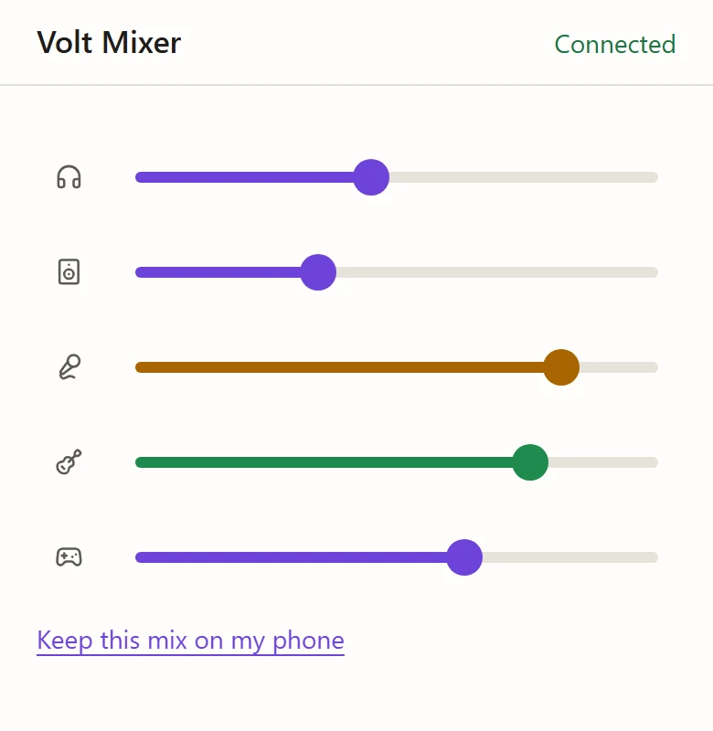

# Volt Mixer

Control the mixer in your Universal Audio **Volt 4 Gen 2** without installing UAD Console. Use it
in your browser, or as a small desktop app. The **[guide](https://naovixen.github.io/volt-mixer/guide/)**
shows what every control does, with step-by-step examples.

## Use it in your browser

1. Plug in your Volt.
2. Open **[naovixen.github.io/volt-mixer](https://naovixen.github.io/volt-mixer/)** in Microsoft Edge
   or Google Chrome. Firefox and Safari can't talk to the Volt.
3. Choose **Connect Volt** and pick your Volt from the list.
4. The first time, choose **Start from Console's defaults**, or open a mix link from another
   computer.

Close UAD Console if it's open on the same computer.

## Desktop app

For Windows, macOS and Linux. It connects by itself and sits in the taskbar: click its icon for a
quick mixer.

Download it from [Releases](https://github.com/naovixen/volt-mixer/releases). The first time you open
it:

- **Windows:** if SmartScreen appears, choose **More info › Run anyway**.
- **macOS:** open it, then go to **System Settings › Privacy & Security › Open Anyway**.
- **Linux:** use the `.deb`. For the AppImage, see [Linux USB access](DEVELOPMENT.md#linux-usb-access).

To keep the Volt's display dark overnight, turn on **Settings › Desktop app › Volt display off at sleep**.
It turns off when the computer sleeps or shuts down, and back on when Volt Mixer next connects.

## On another computer

In **Settings › Your mix**, click the **Mix link** to copy it, or choose **QR code**. Open the link
on the other computer.

## On your phone

Your phone can do two things, each with its own QR code:

- **Carry your mix** to another computer: scan **Settings › Your mix › QR code**. Volt Mixer on the
  phone keeps the mix; at the other computer, scan the phone's code with its camera. Works with
  just the website.
- **Change levels** as a remote: in the desktop app, turn on **Settings › Desktop app › Phone
  remote** and scan its code. Your phone needs to be on the same Wi-Fi.

<picture>
    <source media="(prefers-color-scheme: dark)" srcset="public/guide/images/remote-dark.webp">
    
</picture>

## Everything else

Every control, setting and message is explained in the
**[Volt Mixer guide](https://naovixen.github.io/volt-mixer/guide/)**.

## Other interfaces

Only the Volt 4 Gen 2 works for now. Have a different Volt? You can help add it:
see [DEVELOPMENT.md](DEVELOPMENT.md).

## Licence

[MIT](LICENSE). Not affiliated with Universal Audio.
