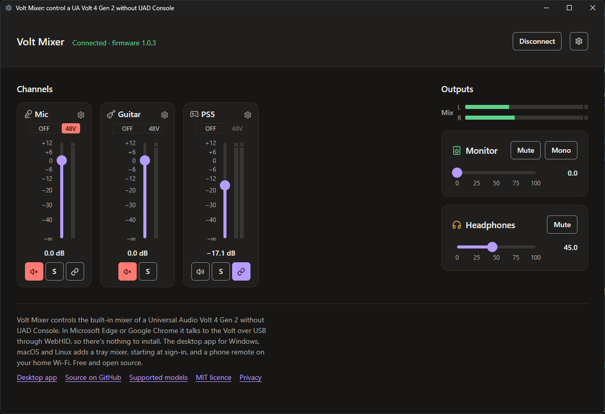
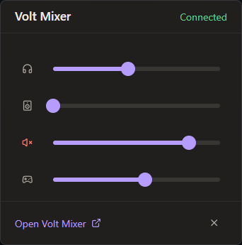
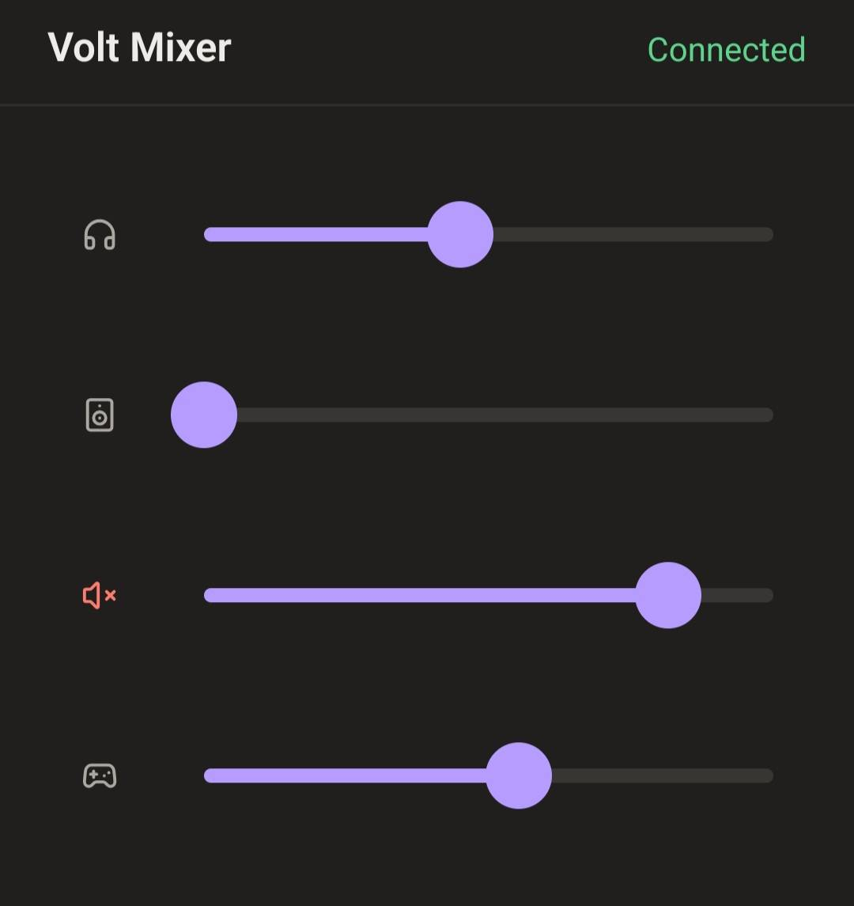

# Volt Mixer

Control the mixer in your Universal Audio **Volt 4 Gen 2** without installing UAD Console. Use it
in your browser, or as a small desktop app.

## Use it in your browser

1. Plug in your Volt.
2. Open **[naovixen.github.io/volt-mixer](https://naovixen.github.io/volt-mixer/)** in Microsoft Edge
   or Google Chrome. Firefox and Safari can't talk to the Volt.
3. Choose **Connect Volt** and pick your Volt from the list.
4. The first time, choose **Start from Console's defaults**, or open a mix link from another
   computer.

Close UAD Console if it's open on the same computer.

## Desktop app

For Windows, macOS and Linux. It connects by itself and sits in the taskbar: click its icon for a
quick mixer.

Download it from [Releases](https://github.com/naovixen/volt-mixer/releases). The first time you open
it:

- **Windows:** if SmartScreen appears, choose **More info › Run anyway**.
- **macOS:** open it, then go to **System Settings › Privacy & Security › Open Anyway**.
- **Linux:** use the `.deb`. For the AppImage, see [Linux USB access](DEVELOPMENT.md#linux-usb-access).

## On your phone

In the desktop app, turn on **Settings › Desktop app › Phone remote** and scan the QR code. Your phone needs to
be on the same Wi-Fi.

## On another computer

In **Settings › Your mix**, click the **Mix link** to copy it, or choose **Show QR code**. Open the
link on the other computer.

## Other interfaces

Only the Volt 4 Gen 2 works for now. Have a different Volt? You can help add it:
see [DEVELOPMENT.md](DEVELOPMENT.md).

## Licence

[MIT](LICENSE). Not affiliated with Universal Audio.
